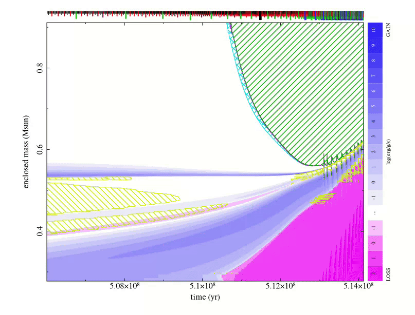
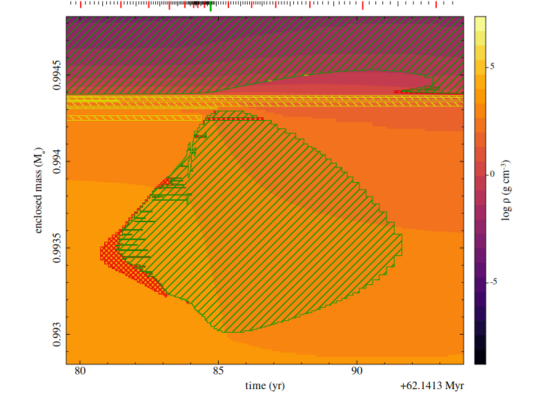
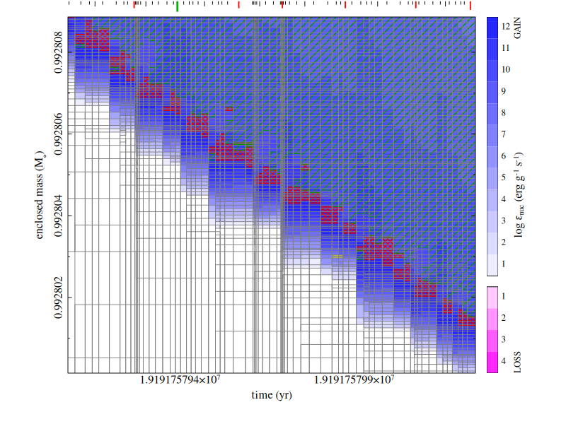
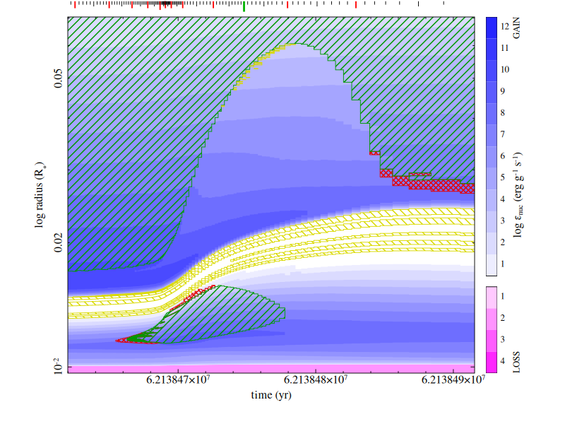

# kippy

[](https://pypi.org/project/kippy/)
[](https://pypi.org/project/kippy/)
[](https://github.com/rileythai/kippy/blob/main/COPYING.LESSER)
[](https://github.com/rileythai/kippy/actions/workflows/wheels.yml)
[](https://kippy.rileythai.com)



`kippy` is an interactive Kippenhahn diagram diagnostic tool for various stellar
evolution codes, including [MESA](https://mesastar.org) profiles or
[customized raw binary (`.kipp`) streams](https://kippy.rileythai.com/kippfiles/),
[KEPLER](https://2sn.erc.monash.edu/kepler/doc)-style `.cnv` files, and MONASH `.seq`
files.

`kippy` is built in Fortran for high performance and out-of-memory access for
even the longest stellar evolution runs. The plotting uses the
[cairo](https://www.cairographics.org/) graphics library via
[giza](https://danieljprice.github.io/giza).

`kippy` is based on the interactive Kippenhahn diagram viewer originally written
by [Alexander Heger](https://2sn.erc.monash.edu/) for KEPLER, and is maintained
by [Riley Thai](https://rileythai.com).

Full documentation at <https://kippy.rileythai.com>.





## Install

kippy runs on Linux and macOS >15, see [PyPI](https://pypi.org/project/kippy/),

```bash
pip install kippy
```
The wheels expect X11, which requires
[XQuartz](https://www.xquartz.org/) on macOS (see below). Most Linux distros ship with X11.

### Build from source

Building from source (the sdist, or a clone) compiles the Fortran core and the
bundled giza library, so it needs `gfortran`, `meson`, `ninja`, and the cairo,
libx11, and freetype2 development packages:
```bash
# macOS
brew install gcc meson ninja pkgconf cairo libx11 freetype
brew install --cask xquartz # so you can actually display stuff
```
```bash
# ubuntu/debian
sudo apt update
sudo apt install -y build-essential gfortran meson ninja-build pkg-config libcairo2-dev libx11-dev libfreetype-dev
```
```bash
# fedora/rhel/rocky/alma
sudo dnf install -y gcc gcc-c++ gcc-gfortran meson ninja-build pkgconf-pkg-config cairo-devel libX11-devel freetype-devel
```

We recommend using the [`uv`](https://uv.astral.sh) package manager for building from source:

```bash
git clone --recurse-submodules https://github.com/rileythai/kippy && cd kippy
uv sync
```

See further instructions in the [installation guide](https://kippy.rileythai.com/install/) for other notes on editable
installs with `uv`.

## Quick start

```bash
convview path/to/model.cnv      # interactive viewer
convdump path/to/model.cnv      # print reader summary
```

```python
import kippy

# print first/last model summary stats
print(kippy.dump("model.cnv"))

# render a PNG non-interactively for a cnv file
kippy.view("model.cnv", commands=["save kipp.png", "quit"])

# or launch the interactive REPL for a kipp file
kippy.view("model.kipp")
```

The reader is chosen from the path at load automatically. See the documentation on
[input formats](https://kippy.rileythai.com/formats/) and the
[usage guide](https://kippy.rileythai.com/usage/) for cursor-mode keys and REPL
commands.

## License

kippy is licensed under the
[GNU Lesser General Public License v3.0 or later](https://github.com/rileythai/kippy/blob/main/COPYING.LESSER).
The [giza](https://github.com/danieljprice/giza) library is LGPLv3.
