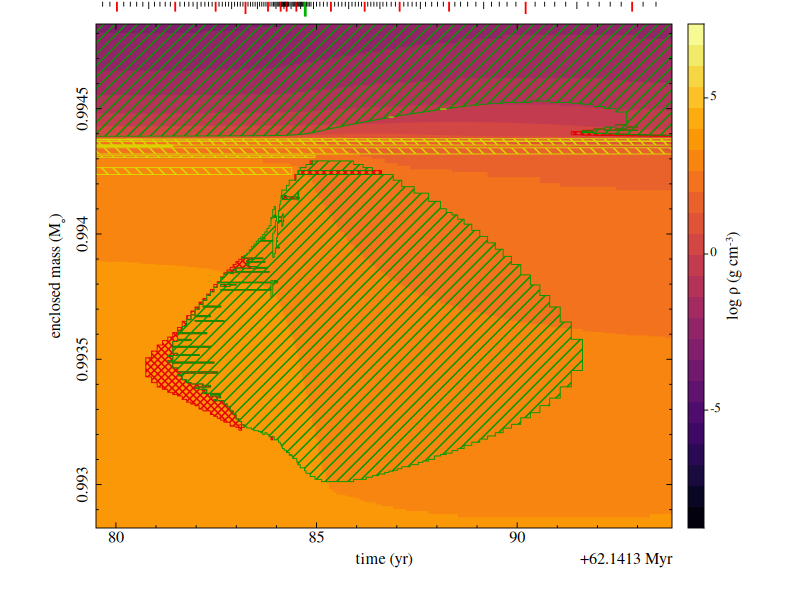
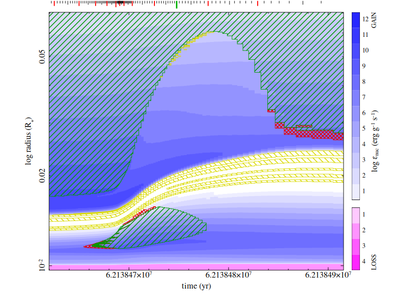
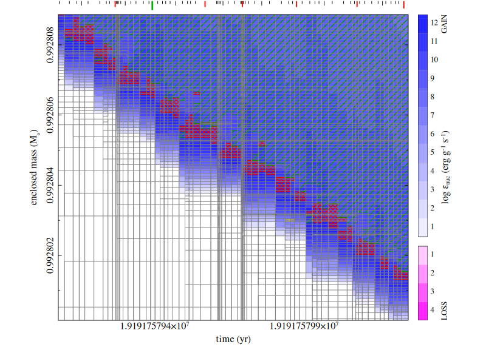
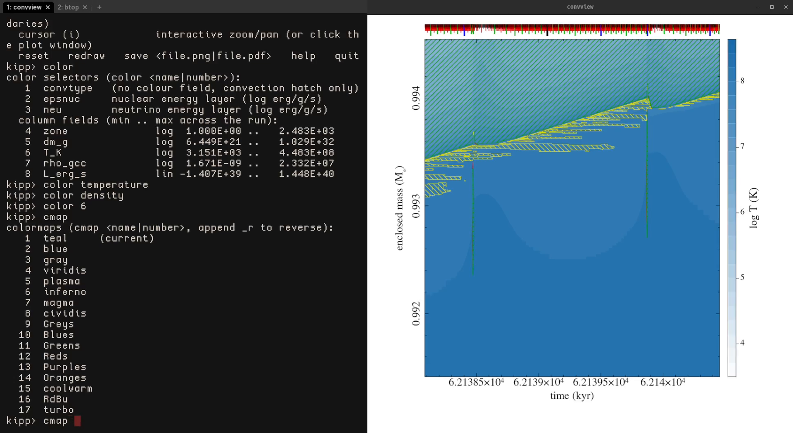

# `kippy`

<video src="kippy_demo_v2.webm" autoplay loop muted playsinline title="Demonstration of kippy on an AGB model from MESA"></video>

`kippy` is an interactive Kippenhahn diagram diagnostic tool for various stellar
evolution codes, including [MESA](https://mesastar.org) profiles or
[customized raw binary (`.kipp`) streams](https://kippy.rileythai.com/kippfiles/),
[KEPLER](https://2sn.erc.monash.edu/kepler/doc)-style compressed `.cnv` files, and MONASH `.seq`
files.

`kippy` is built in Fortran for high performance and out-of-memory access for
even the longest stellar evolution runs. Plots use the
[cairo](https://www.cairographics.org/) graphics library via
[giza](https://danieljprice.github.io/giza).

Get started with:

 * [Installing `kippy`](install.md)
 * [How to make `MESA` write `kipp` and `cnv` files](mesa.md)
 * [Quick Start: Usage guide for interactive and REPL interfaces](usage.md)
 * [Supported input formats](formats.md)
 * [Python API documentation](api.md)

## Quick start

After [installing kippy](install.md), you can open a model in the interactive viewer:

```bash
convview path/to/model.cnv
```

Or launch it from Python:

```python
import kippy

kippy.view("path/to/model.cnv")
```


<div class="grid" markdown>

  

  

  

  

  </div>


`kippy` is based on the interactive Kippenhahn diagram viewer originally written
by [Alexander Heger](https://2sn.erc.monash.edu/) for [`KEPLER`](https://2sn.erc.monash.edu/kepler/doc), and is maintained
by [Riley Thai](https://rileythai.com).
