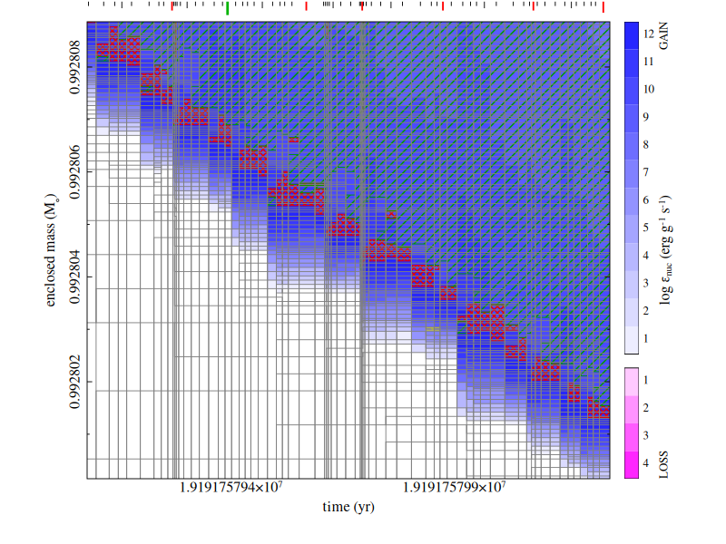
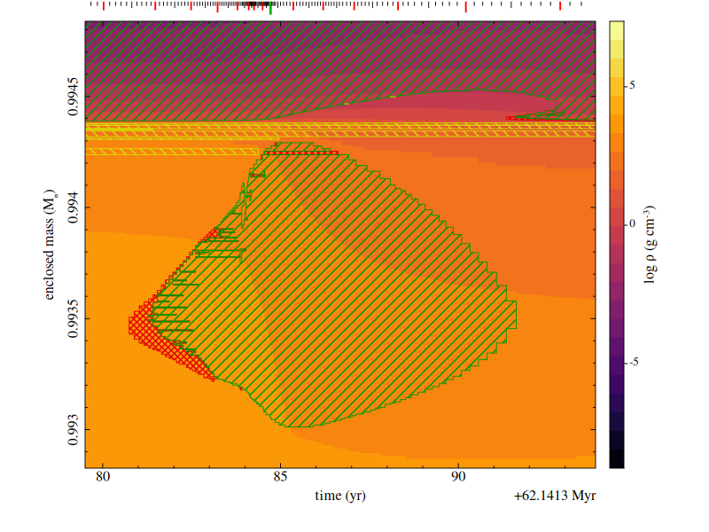
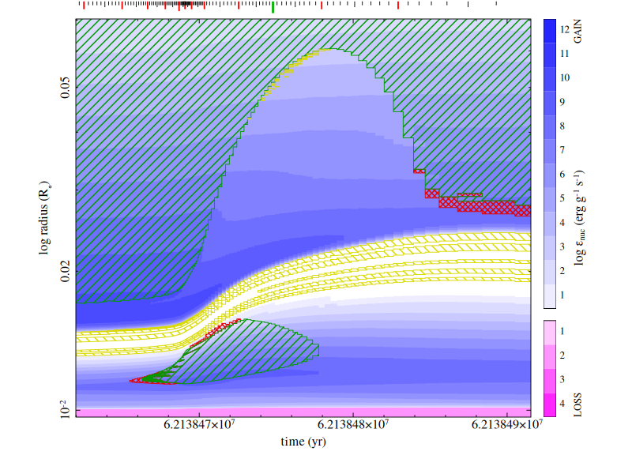

# Usage

## Command line

`convview` loads a convection data file, renders a Kippenhahn diagram, and provides a
command prompt:

```text
convview [path]
```

`convdump` loads the same data and prints the number of models followed by
summary values for the first and last models:

```text
convdump [path]
```

Both commands use `convdata.cnv` in the current directory when `path` is
omitted. Only the first command-line argument is used as the path.

When `DISPLAY` is non-empty, `convview` will open an interactive `/xw` window. It
renders once and enters Cursor mode (see below) before showing the `kipp>` prompt.
On macOS the window needs XQuartz (see [macOS](install.md#macos)).

Press `q`, `Esc` or `Ctrl-C` in the plot window to leave cursor mode and reach the prompt for REPL commands (see below).
Click the plot window (left, middle or right button) at the prompt to enter cursor mode again; the click itself does nothing else.
Closing the plot window quits `convview`, from cursor mode or the prompt.
Clicks and closing are only watched when standard input is a terminal and `KIPP_SCRIPT` is not set.

## Cursor mode

Cursor mode uses the mouse position in the plot window with custom Vim-like keybinds (`hjkl`). Zoom and pan operate
in the current linear or logarithmic window coordinates.

See the [command reference](commands.md#cursor-mode) for every key and mouse action.

<video src="kippy_demo_v2.webm" autoplay loop muted playsinline title="Demonstration of kippy on an AGB model from MESA"></video>

### Convective hatching style

Mixing regions are hatched over the color field and outlined in their color;
radiative regions are left clear. `color convtype` shows the hatching alone.

| Zone type | Color | Hatching |
| --- | --- | --- |
| Convective | Green | `/` |
| Overshoot | Magenta | `+` |
| Semiconvective | Red | Dense `X` |
| Thermohaline | Yellow | `\` |
| Neutral | Cyan | `X` |

See the [MESA mixing codes](kippfiles.md#required-columns) and
[KEPLER zone types](cnvfiles.md#convection-zones) for how each input maps onto
these types.


### Resolution grid

`grid on`, or toggle `g` in cursor mode will draw the stored cell faces of every model
and the boundaries between them, so you can check whether a feature is
resolved in space and time.

Zooming in is crucial! Any lines closer than a single pixel are obviously 
invisible, so zoom in until you can see the cells separate.

The example below zooms into hot third dredge-up in a
6 solar-mass AGB star run with MESA; each grey box is one cell of one stored
model. Arguably, I might be using too little time resolution here!




## REPL commands

`kippy` also provides a general REPL interface to switch the color field, and axis scalings.

<video src="repl_demo.webm" controls muted playsinline title="Switching between the kipp> prompt and cursor mode"></video>

See the [command reference](commands.md#repl-commands) for every command.


### Color fields

Use `color` to list the different fields that can be shown: the fixed
selectors, then any registered columns of the input with their scale and range
across the run. For a typical MESA-written `.kipp`:

```text
kipp> color
color selectors (color <name|number>):
   1  convtype   (no colour field, convection hatch only)
   2  epsnuc     nuclear energy layer (log erg/g/s)
   3  neu        neutrino energy layer (log erg/g/s)
  column fields (min .. max across the run):
   4  zone              log  1.000E+00 ..   2.483E+03
   5  dm_g              log  6.449E+21 ..   1.029E+32
   6  T_K               log  3.151E+03 ..   4.483E+08
   7  rho_gcc           log  1.671E-09 ..   2.332E+07
   8  L_erg_s           lin -1.407E+39 ..   1.448E+40
```

Select a field by name or number, for example `color rho_gcc` or `color 7`.
`cmap` with no argument lists the colormaps, selected the same way:

```text
kipp> cmap
colormaps (cmap <name|number>, append _r to reverse):
   1  teal     (current)
   2  blue
   3  gray
   4  viridis
   5  plasma
   6  inferno
   7  magma
   8  cividis
   9  Greys
  10  Blues
  11  Greens
  12  Reds
  13  Purples
  14  Oranges
  15  coolwarm
  16  RdBu
  17  turbo
```

For example, this is `color rho_gcc` with `cmap inferno` centered on a flash-driven convective region of the 5th thermal pulse of a 6 solar-mass AGB star.



Friendly column aliases recognized by the renderer are `temperature`, `temp`,
or `T`; `density`, `rho`, or `Rho`; `luminosity`, `lum`, or `L`; and `pressure`
or `P`. Each alias will select the first corresponding field present in
the input. See [colour fields](formats.md#colour-fields) for how values are
binned.

### Axes

Using the `xaxis` and `yaxis` commands you can change the plot to use model number instead of time, or radius instead of mass.
For example, `yaxis radius` plots radius instead of enclosed mass, and `yscale log` spreads
out compact cores. 

Each of these autoscales the axis it changes, while `units` changes an axis unit and
keeps the current view, for example `units km`.

The example shows the same AGB star as the color field example, two thermal
pulses earlier, between about 0.01 and 0.07 solar radii with `yaxis radius` and
`yscale log`:



## Headless rendering and scripting

To enable scripting, `kippy`'s core interface supports a headless rendering mode and scripted rendering.

### Headless rendering
When `DISPLAY` is unset or empty, as on macOS without XQuartz, `convview` uses
the `/png` device. The initial render writes
`convview.png`; each command that renders again replaces that file. Cursor mode
is unavailable in this mode. Use `save` to write a separately named PNG or PDF.

Setting `KIPP_SCRIPT` to any non-empty value skips automatic entry into cursor
mode when an interactive window is available. It also enables the `key` REPL
command.


### Scripted rendering

Set `KIPP_SCRIPT` when piping commands so an available X window does not enter
cursor mode before reading standard input:

```sh
printf '%s\n' \
  'xaxis model' \
  'color epsnuc' \
  'cmap viridis' \
  'save diagram.png' \
  'quit' | KIPP_SCRIPT=1 convview path/to/model.cnv
```

To force the regular render device to be headless as well, remove `DISPLAY`
from the command environment, for example with `env -u DISPLAY`.

The Python API feeds `commands` to the same REPL. Set `KIPP_SCRIPT` in the
process environment to skip automatic cursor mode when `DISPLAY` is present:

```python
import os

import kippy

os.environ["KIPP_SCRIPT"] = "1"
kippy.view(
    "path/to/model.cnv",
    commands=[
        "xaxis model",
        "color epsnuc",
        "cmap viridis",
        "save diagram.pdf",
        "quit",
    ],
)
```
